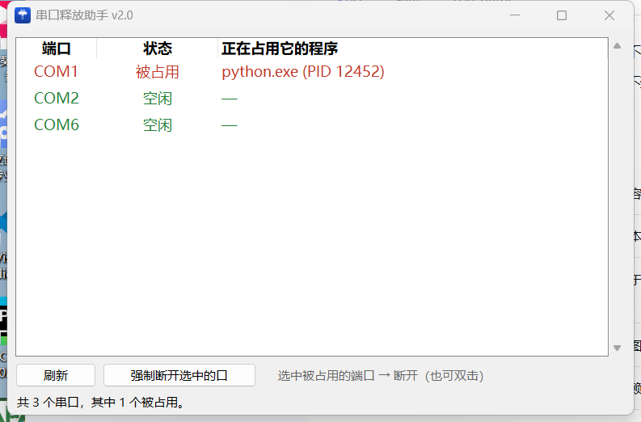

# 串口释放助手 · SerialPortReleaser

> COM 口打不开、报"拒绝访问"、又看不出是谁占着它？这个工具帮你指出来，并且一键抢回来。**不用重启电脑，不用拔 USB 线。**



串口调试最烦的一幕：上一个程序崩了或者忘了关，`COM6` 打不开。设备管理器只告诉你"这个端口存在"，任务管理器里一堆同名进程，谁也看不出到底是谁捏着那个串口不放。

这个工具只做三件事，多一件都不做：

1. **列出所有串口**，并在旁边直接写清楚是哪个程序在占用它（进程名 + PID）
2. **选中被占用那个口，点一下"强制断开"**
3. **断开后自动复查**，明确告诉你"现在空闲了吗"，而不是让你自己猜

---

## 特点

| | |
|---|---|
| 零第三方依赖 | 纯 Python 标准库：界面 `tkinter`、系统调用 `ctypes`。不用装 pyserial、不用 pywin32、不用 Qt |
| 单文件 EXE | 11 MB，双击即跑。目标机器不需要 Python 运行时，也不需要 .NET |
| 源码只有 500 行 | 全部逻辑在一个文件里，段落之间有小标题，可以直接读完再决定要不要信它 |
| 系统跨度大 | Windows 7 / 8 / 10 / 11（64 位），从 Win7 时代的 API 一路兼容到现在 |
| 精确到句柄 | 关掉的是"持有该串口的那个句柄"，不是结束进程、不是重启服务 |
| 高 DPI 友好 | 125% / 150% 缩放下界面不糊、不拉伸 |

---

## 原理（看完就知道它到底干了什么）

### 1. 枚举有哪些串口

读注册表 `HKEY_LOCAL_MACHINE\HARDWARE\DEVICEMAP\SERIALCOMM` 拿到 `COM1`、`COM6` 这类名字；
再用 `QueryDosDevice("COM6")` 换出内核设备路径 `\Device\VSerial0`。

后者是后面认出"谁占着它"的关键 —— 句柄表里存的是这条内核路径，不是 `COM6`。

### 2. 判断是空闲还是被占用

直接用 `CreateFile("\\.\COM6", GENERIC_READ|GENERIC_WRITE, 共享模式=0)` 试着独占打开：

- 打开成功 → 空闲（马上关掉）
- 错误码 5（拒绝访问）/ 32（共享冲突） → 被占用
- 错误码 2 / 3（找不到路径） → 端口不存在

**这跟应用程序自己打开串口是同一套规则**，所以不会出现"工具说空闲、程序却打不开"的误判。

### 3. 找出是哪个程序占着它

这是整个工具唯一有点门槛的地方：

1. `NtQuerySystemInformation(SystemExtendedHandleInformation)` 拉出全系统句柄表（一般 10 万条以上）
2. 先粗筛：只保留对象类型是 **File** 的句柄。File 的类型索引不固定，所以先在自己进程里开一个临时文件，反查它对应的 `ObjectTypeIndex`，用它当过滤器
3. `DuplicateHandle` 把候选句柄复制进本进程，然后 —— **必须先 `GetFileType` 判断是不是 `FILE_TYPE_CHAR`（字符设备），通过了才去 `NtQueryObject` 问对象名**

> 第 3 步的顺序是有血泪的。反过来先问名字，遇到某些挂在命名管道上、I/O 已挂起的句柄，`NtQueryObject` 会**永久阻塞**，整个工具就僵在那里。先问类型、后问名字，可以躲开这个坑。

4. 拿到的对象名与 `QueryDosDevice` 得到的设备路径匹配上 → 这个 PID 就是占用者，再用 `QueryFullProcessImageNameW` 取进程名给人看

### 4. 释放

```python
DuplicateHandle(hProc, 旧句柄, 本进程, &新句柄, 0, False, DUPLICATE_CLOSE_SOURCE)
```

`DUPLICATE_CLOSE_SOURCE` 的含义是"复制完之后，把源进程里的那个句柄关掉"。
**效果等同那个程序自己调了一次 `CloseHandle`** —— 进程照常活着，只是它手里的串口没了。

所以：不会强杀进程、不会丢它没保存的数据。代价是它会认为串口"突然消失"，之后读写可能报错。

---

## 使用

### 方式一：下载现成的 EXE

到 [Releases](../../releases) 下载 `串口释放助手.exe`，双击运行。

- 对高权限进程（服务、以管理员身份运行的程序）动手时，请右键 → **以管理员身份运行**
- 界面里红色 = 被占用，绿色 = 空闲；选中后点「强制断开选中的口」或直接双击

### 方式二：直接跑源码

```bash
python serial_release.py
```

Python 3.8+，Windows 上即可，无需 `pip install` 任何东西。

### 方式三：自己打包单文件 EXE

```bash
pip install pyinstaller
python -m PyInstaller --noconfirm --clean --onefile --windowed ^
  --name SerialRelease --icon app.ico --version-file version.txt ^
  --add-data "app.ico;." ^
  --exclude-module numpy --exclude-module pandas --exclude-module matplotlib ^
  --exclude-module scipy --exclude-module PIL --exclude-module PyQt5 ^
  --distpath dist --workpath build serial_release.py
```

或者直接双击仓库里的 `build.bat`（会自动找 `python` 并顺手改好 exe 的文件名）。

---

## 已知限制（先看这里，能省你很多疑惑）

- **"未查到进程"的口断不掉。** 这种情况是驱动或系统服务在占用，句柄不在用户态进程里。解决办法只有在设备管理器里对该串口 **右键 → 禁用 → 启用**。
- **断开成功后，端口不一定立刻空闲。** 实测有些 USB 转串口驱动要十几秒才真正放掉设备。工具会盯 5 秒，之后请再点「刷新」确认；一直不放开就禁用/启用设备。
- **有些程序会自动重连。** 句柄一关它马上重新打开，界面会提示 `COM6 又被 xxx.exe 打开了（程序可能自动重连）`。这时候要么先关掉那个程序，要么在它设置里关掉自动重连。
- **32 位系统 / ARM64 未测试。** 句柄结构体在 32 位下布局不同，理论上需要调整。
- **杀软可能拦截。** 遍历句柄 + 复制句柄 + 关闭他人句柄，这套动作在行为上和某些恶意软件高度相似。介意的话自己读源码再运行，或者自己编译一份。

---

## 风险提示

**它会替另一个程序关掉它正在使用的文件句柄。**

- 那个程序可能报错、功能异常，最坏情况下崩溃
- 如果它此刻正在往外写串口数据，那部分数据会丢掉
- 请只在"反正我也准备重启它了"的场景下用；别人正在跑的生产程序，别动

如果 5 秒内你就要决定删不删，那就是：**这是个急救工具，不是日常工具。**

本项目按 MIT 协议开源，作者不对使用后果承担任何责任。

---

## License

[MIT](LICENSE) © 2026 zhangheng1988

---

## English

**SerialPortReleaser** — a tiny Windows utility that tells you *which process is holding your COM port* and lets you take it back with one click. No reboot, no unplugging cables.

- Pure Python standard library (`tkinter` + `ctypes`), no third-party packages
- Single-file 11 MB EXE, no Python runtime needed on the target machine
- Windows 7 / 8 / 10 / 11 (64-bit)
- Finds the owner by enumerating the system handle table (`SystemExtendedHandleInformation`), filtering for `FILE_TYPE_CHAR` handles, and resolving their object names; releases by `DuplicateHandle(..., DUPLICATE_CLOSE_SOURCE)` — the target process keeps running, only its COM handle is closed
- Driver-level holders can't be released this way (disable/enable the device in Device Manager instead)

Use at your own risk: it closes a handle another program is actively using.
